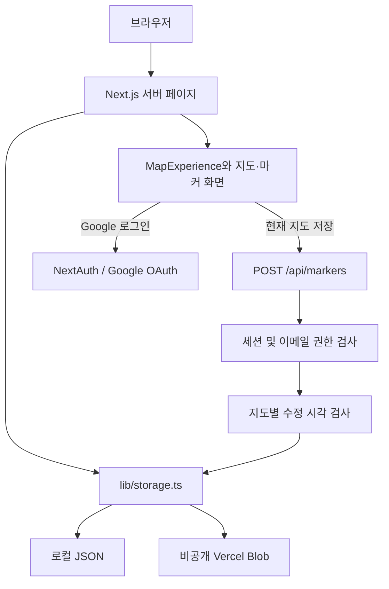

# BAG Map Viewer

PUBG 지도를 확대·이동하며 차량, 배, 주유소, 글라이더, 차고, 비밀방 위치를 확인하는 웹 앱입니다. 일반 방문자는 로그인 없이 지도를 보고, 운영자가 지정한 관리자만 마커를 편집합니다.

이 저장소는 누구나 자신의 Google OAuth 앱과 저장소를 연결해 독립적으로 실행할 수 있는 공용 버전입니다. 기존 운영자의 계정이나 토큰은 필요하지 않습니다.

## 주요 기능

- 에란겔, 미라마, 태이고, 데스턴, 비켄디, 론도 지도
- 마우스 휠 확대·축소, 드래그 이동, 마커 종류별 표시 전환
- 아이콘 배경 설정과 마지막 선택 지도 기억
- Google 로그인과 서버에서 확인하는 관리자 권한
- 관리자 마커 추가·이동·삭제 및 지도별 저장
- 다른 관리자가 먼저 저장했을 때 충돌 안내
- 로컬 JSON 저장 또는 비공개 Vercel Blob 저장

## 기술 구성

| 영역 | 사용 기술 |
| --- | --- |
| 화면 및 서버 | Next.js 16 App Router, React 19, TypeScript |
| 스타일 | 일반 CSS (`app/globals.css`) |
| 인증 | NextAuth.js 4, Google OAuth, JWT 세션 쿠키 |
| 저장 | Node.js 파일 시스템 / `@vercel/blob` |
| 지도 | WebP 이미지와 SVG 마커, 3072 × 3072 좌표계 |
| 선택 사항 | Vercel Analytics, Speed Insights (기본 비활성화) |

정확한 설치 버전은 `package-lock.json`을 기준으로 합니다. 별도 DB는 필요하지 않습니다.

## 빠른 실행

[Node.js 20.9 이상](https://nextjs.org/docs/app/getting-started/installation#system-requirements)과 npm, Git을 준비합니다.

```sh
git clone https://github.com/tlanfk/bagweb.git
cd bagweb
npm ci
npm run dev
```

[http://localhost:3000](http://localhost:3000)을 엽니다. 지도 열람에는 환경변수가 필요하지 않습니다. 관리자 로그인은 다음 설정을 완료한 뒤 사용합니다.

프로덕션 모드로 실행하려면:

```sh
npm run build
npm start
```

## 관리자 로그인 설정

1. `.env.local.example`을 `.env.local`로 복사합니다. Windows PowerShell에서는 아래 명령을 사용합니다.

   ```powershell
   Copy-Item .env.local.example .env.local
   ```

2. Google Cloud Console에서 OAuth 동의 화면과 **웹 애플리케이션** 유형의 OAuth 클라이언트를 만듭니다. 앱이 테스트 모드라면 사용할 계정을 테스트 사용자에 추가합니다.
3. 승인된 리디렉션 URI에 `http://localhost:3000/api/auth/callback/google`을 등록합니다. 배포용 URI는 `https://내-도메인/api/auth/callback/google` 형식입니다. [NextAuth Google 설정 문서](https://next-auth.js.org/providers/google)를 참고하세요.
4. `.env.local`에 다음 값을 채웁니다.

   ```dotenv
   NEXTAUTH_URL=http://localhost:3000
   AUTH_SECRET=직접-생성한-무작위-비밀값
   AUTH_GOOGLE_ID=발급받은-OAuth-클라이언트-ID
   AUTH_GOOGLE_SECRET=발급받은-OAuth-클라이언트-비밀값
   SUPER_ADMIN_GOOGLE_EMAIL=owner@example.com
   ADMIN_GOOGLE_EMAILS=editor@example.com
   ```

   위 이메일은 예시입니다. 실제 사용할 Google 계정으로 바꿉니다. 비밀값은 다음 명령으로 생성할 수 있습니다.

   ```sh
   node -e "console.log(require('node:crypto').randomBytes(32).toString('base64url'))"
   ```

5. 서버를 재시작하고 `/admin`에서 Google로 로그인합니다.

| 환경변수 | 용도 | 필요 시점 |
| --- | --- | --- |
| `NEXTAUTH_URL` | 서비스의 실제 접속 주소 | 관리자 인증 |
| `AUTH_SECRET` | JWT·세션 서명 비밀값 | 관리자 인증 |
| `AUTH_GOOGLE_ID` | Google OAuth 클라이언트 ID | 관리자 인증 |
| `AUTH_GOOGLE_SECRET` | Google OAuth 클라이언트 비밀값 | 관리자 인증 |
| `SUPER_ADMIN_GOOGLE_EMAIL` | 마커 편집 및 편집자 이메일 관리 권한을 가진 계정 | 최종 관리자 지정 |
| `ADMIN_GOOGLE_EMAILS` | 쉼표로 구분한 초기 편집자 계정 | 선택 |
| `BLOB_READ_WRITE_TOKEN` | 본인 소유 비공개 Blob 저장소 토큰 | Vercel에서 편집 내용을 영속 저장할 때 |
| `NEXT_PUBLIC_ENABLE_ANALYTICS` | `true`일 때만 Vercel 방문·성능 분석 사용 | 선택, 기본 꺼짐 |

기존 설정과의 호환을 위해 `NEXTAUTH_SECRET`, `GOOGLE_CLIENT_ID`, `GOOGLE_CLIENT_SECRET`, `GOOGLE_ID`, `GOOGLE_SECRET`도 지원합니다. 새 설치에서는 표의 이름을 사용하세요. `AUTH_*` 값이 우선합니다.

### 권한 구분

- **방문자:** 로그인 없이 지도와 마커를 조회합니다.
- **편집자:** `ADMIN_GOOGLE_EMAILS` 또는 저장된 편집자 목록에 포함된 계정입니다. 마커를 편집·저장할 수 있습니다.
- **최종 관리자:** `SUPER_ADMIN_GOOGLE_EMAIL`에 지정한 계정입니다. 마커 편집과 `권한 이메일` 버튼을 통한 편집자 목록 관리를 할 수 있습니다.

고정된 관리자 계정은 없습니다. 최종 관리자 환경변수가 비어 있으면 해당 권한은 누구에게도 부여되지 않습니다. 환경변수로 추가한 편집자는 화면에서 지워도 환경변수에 남아 있으면 권한을 유지합니다. 권한을 회수할 때는 해당 환경변수도 수정하고 다시 배포하세요.

## 사용 방법

1. 좌측 `MAP LIST`에서 지도를 선택합니다.
2. 마우스 휠로 확대·축소하고 지도를 드래그해 이동합니다.
3. 마커 종류 버튼으로 표시 여부를 전환합니다. `아이콘 배경`으로 배경을 켜거나 끕니다.
4. 관리자는 `/admin`에서 로그인한 뒤 `편집`을 켭니다.
5. 사이드바의 마커를 지도로 드래그해 추가합니다. 기존 마커를 드래그해 이동하고 선택한 마커는 Delete/Backspace로 삭제합니다.
6. `저장하기`는 **현재 선택한 지도**의 변경분을 저장합니다. 한 지도씩 편집·저장한 뒤 다음 지도로 이동하세요. 여러 지도의 미저장 변경을 쌓아두면 저장 과정에서 다른 지도의 변경이 사라질 수 있습니다. 저장하지 않은 변경은 편집 종료·새로고침 때도 사라질 수 있습니다.

## 동작 방식



### 조회

`app/page.tsx`와 `app/admin/page.tsx`가 서버에서 마커, 표시 설정 쿠키, 로그인 세션을 읽습니다. `MapExperience`는 받은 데이터를 바탕으로 지도 이미지 위에 마커를 겹쳐 표시합니다. 관리자 이메일 목록은 지도 데이터에서 제외하고, 별도의 권한 정보에서도 최종 관리자에게만 전달합니다.

### 좌표와 편집

화면에서 클릭한 위치를 원본 지도 기준 `0~3072` 좌표로 변환하고 정수 범위로 제한합니다. 각 마커는 `id`, `x`, `y`를 가집니다. 클라이언트는 저장된 원본과 편집 중인 초안을 별도로 관리합니다.

```json
{
  "id": "marker-example",
  "x": 1536,
  "y": 1024
}
```

### 저장과 충돌 확인

클라이언트가 `mapId`, `groups`, `lastKnownUpdatedAt`을 전송하면 서버가 세션과 편집 권한을 검사합니다. 서버에 저장된 해당 지도의 수정 시각이 다르면 `409`를 반환해 덮어쓰기를 막고, 같으면 좌표를 정규화해 저장합니다. DB 트랜잭션이나 원자적 잠금은 없으므로 동시에 들어온 저장 요청까지 완전히 직렬화하는 구조는 아닙니다.

### 표시 설정

선택한 지도와 아이콘 배경 설정은 브라우저의 localStorage와 1년 유효 쿠키에 저장합니다. 다음 요청 때 서버가 쿠키를 읽어 첫 화면에 같은 설정을 적용합니다. 로그인은 별도의 HTTP-only 세션 쿠키를 사용합니다.

## 저장 방식

### 로컬 또는 영속 디스크가 있는 Node.js 서버

`BLOB_READ_WRITE_TOKEN`이 없으면 파일 모드입니다.

- 최초 조회: 공개 초기 데이터 `data/markers.json`
- 첫 저장 이후: 개인 운영 데이터 `data/markers.local.json`
- `markers.local.json`에는 마커와 운영자가 등록한 편집자 이메일이 포함됩니다. Git에서 제외되며 별도로 백업해야 합니다.
- 초기 데이터를 갱신해 공유하려면 운영 데이터의 `adminEmails`를 비운 뒤 마커 데이터만 초기 파일에 반영하세요.

### Vercel Blob

`BLOB_READ_WRITE_TOKEN`을 설정하면 파일 모드 대신 **비공개 Blob**을 사용합니다. [Blob SDK 문서](https://vercel.com/docs/vercel-blob/using-blob-sdk)를 참고하세요.

```text
pubg-map-editor/
├── meta.json          # 버전, 수정 시각, 편집자 이메일 (비공개)
└── maps/
    ├── erangel.json
    ├── miramar.json
    ├── taego.json
    ├── deston.json
    ├── vikendi.json
    └── rondo.json
```

지도별 저장은 메타데이터와 해당 지도만 갱신합니다. 예전 단일 파일 `pubg-map-editor/markers.json`도 읽을 수 있습니다. 새 Blob 저장소는 빈 지도 데이터로 시작하며, 로컬 초기 데이터가 자동 업로드되지는 않습니다. 로컬 데이터와 Blob 데이터는 별개입니다.

## API

| 경로 | 메서드 | 동작 | 권한 |
| --- | --- | --- | --- |
| `/api/markers` | GET | 전체 지도 마커 조회, `adminEmails`는 빈 배열 | 공개 |
| `/api/markers` | POST | 현재 지도 마커 저장, 응답에서 이메일 목록 제외 | 편집자·최종 관리자 |
| `/api/admin-emails` | POST | 저장된 편집자 이메일 목록 변경 | 최종 관리자 |
| `/api/auth/[...nextauth]` | GET / POST | Google 인증과 세션 처리 | NextAuth 관리 |

## 폴더 구조

```text
bagweb/
├── app/
│   ├── page.tsx                    # 공개 지도 화면, 서버 데이터 로딩
│   ├── admin/page.tsx              # 관리자 화면, 서버 권한 확인
│   ├── layout.tsx                  # 세션 공급자, 메타데이터, 선택적 분석
│   ├── globals.css                 # 전체 UI 스타일
│   └── api/
│       ├── markers/route.ts        # 조회·저장·충돌 검사
│       ├── admin-emails/route.ts   # 최종 관리자의 편집자 목록 변경
│       └── auth/[...nextauth]/route.ts
├── components/
│   ├── map-experience.tsx          # 확대·이동·편집 상태와 저장 요청
│   ├── map-sidebar.tsx             # 지도 목록, 마커 도구, 로그인 버튼
│   ├── map-marker-layer.tsx        # 마커 표시 레이어
│   ├── marker-icon.tsx             # SVG 마커와 드래그 미리보기
│   └── session-provider.tsx        # 클라이언트 세션 공급자
├── lib/
│   ├── types.ts                    # 지도·마커·저장 데이터 타입
│   ├── maps.ts                     # 지도 이미지·마커 종류 정의
│   ├── markers.ts                  # 좌표 정규화, 추가·삭제, 변경 비교
│   ├── storage.ts                  # 로컬 파일 / 비공개 Blob 저장
│   ├── admin-emails.ts             # 환경변수·저장 목록 기반 권한 판단
│   ├── admin-access.ts             # 서버 세션과 화면 전달용 권한 정보
│   ├── viewer-preferences.ts       # 서버 쿠키 읽기
│   └── viewer-preference-keys.ts   # 표시 설정 쿠키 키
├── data/
│   ├── markers.json                # 공개 초기 마커, 개인 이메일 없음
│   └── markers.local.json          # 실행 중 생성, Git 제외
├── public/
│   ├── webp/                       # 지도 이미지 6개
│   └── vector/                     # 마커·메뉴 SVG
├── auth.ts                         # Google OAuth 및 JWT 세션 설정
├── .env.local.example              # 비밀값 없는 환경변수 양식
├── .gitignore                      # 비밀값·운영 데이터·빌드 산출물 제외
├── AGENTS.md                       # 개발 방향과 공개 저장소 규칙
├── next.config.ts
├── package.json
├── package-lock.json
├── tsconfig.json
├── LICENSE
└── THIRD_PARTY_NOTICES.md
```

## Vercel 배포

1. 자신의 GitHub 계정으로 저장소를 Fork하고 Vercel에 Next.js 프로젝트로 가져옵니다.
2. 관리자 인증에 필요한 환경변수를 등록합니다. `NEXTAUTH_URL`은 실제 배포 도메인으로 지정합니다.
3. Google OAuth 클라이언트에 배포 도메인의 콜백 주소를 추가합니다.
4. 편집 내용을 저장하려면 본인 프로젝트에 **Private Blob** 저장소를 연결하고 `BLOB_READ_WRITE_TOKEN`을 설정합니다.
5. 배포 후 지도 조회, 관리자 로그인, 저장 후 새로고침을 확인합니다.

Vercel 실행 환경의 로컬 파일을 영속 저장소로 사용할 수는 없습니다. Blob 없이 배포하면 초기 지도 열람용으로 사용하고, 저장 기능에는 비공개 Blob을 연결하세요. 공유 코드와 별개로 기존 서비스의 환경변수 및 Blob 운영 데이터는 각 운영자가 관리합니다.

## 개발 및 확인

```sh
npm run lint
npx tsc --noEmit
npm run build
```

빌드 성공은 실제 Google OAuth 로그인이나 Blob 저장 성공을 보장하지 않습니다. 본인의 계정과 저장소를 연결한 후 로그인·권한·저장·새로고침 흐름을 별도로 확인해야 합니다.

## 개인정보와 공개 범위

- 개인 관리자 이메일과 내부 IP를 코드 및 공개 초기 데이터에 고정하지 않습니다.
- `.env*` 파일은 예시 파일을 제외하고 Git에서 제외합니다. 토큰과 이메일 설정은 서버 환경변수로만 관리하세요.
- 운영 중 편집자 이메일은 비공개 운영 데이터에 저장되며, 공개 마커 API와 일반 페이지 데이터에서는 제외합니다.
- 로그인은 Google과 NextAuth가 처리하며, 이 프로젝트에는 별도 사용자 DB가 없습니다.
- Vercel 방문·성능 분석은 `NEXT_PUBLIC_ENABLE_ANALYTICS=true`로 명시적으로 켤 때만 렌더링합니다. 변경 후에는 다시 빌드·배포하세요.
- `package.json`의 `private: true`는 실수로 npm 패키지를 배포하지 않도록 하는 설정입니다. GitHub 공개 여부나 소스 실행을 제한하지 않습니다.

## 라이선스 및 게임 자산

직접 작성한 애플리케이션 코드는 [MIT License](LICENSE)로 제공합니다. 게임 지도 이미지, 게임 데이터, 상표 및 출처·라이선스가 별도로 확인되지 않은 SVG 자산은 이 코드 라이선스에 포함되지 않습니다. PUBG 관련 권리는 해당 권리자에게 있습니다. 이 프로젝트는 비공식 팬 도구이며 공식 서비스와의 제휴를 의미하지 않습니다. 재배포·서비스 운영 전에는 [THIRD_PARTY_NOTICES.md](THIRD_PARTY_NOTICES.md)를 확인하세요.
